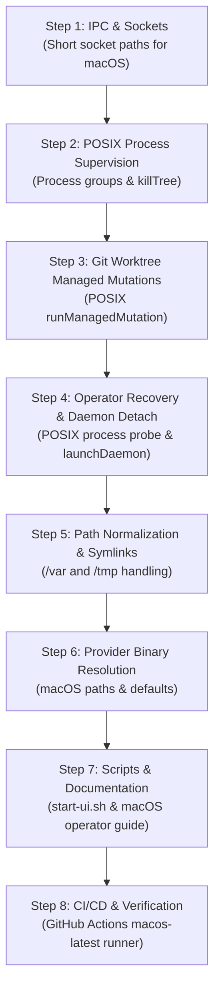

# macOS Support Plan for Agent Broker

## 1. Executive Summary

Agent Broker was initially developed with Windows as the verified host platform, utilizing Windows-specific facilities such as Windows Job Objects (`windowsJobHelper.ps1`), Windows PowerShell daemon detachment (`launchDaemon.ps1`), WMI/CIM process inspection, and `%LOCALAPPDATA%` file conventions.

In accordance with [AGENTS.md](../../AGENTS.md):
- This project is in active pre-release development and backward compatibility is **not a requirement**.
- We prefer the simplest implementation that makes the workflow work reliably.
- Trusted local execution applies: permissions are `read_only` and `workspace_write` for the entire project, without artificial OS sandboxing claims.

This document details the architectural review of the codebase, identifies all platform blockers for macOS (Darwin, Apple Silicon / Intel), and defines a step-by-step implementation plan to achieve full native macOS support.

---

## 2. Review Findings & Platform Blockers

### 2.1 Core IPC & Socket Path Length Limit (`src/daemon/rpc.ts`)
- **Current State**:
  - Windows uses Named Pipes (`\\.\pipe\agent-broker-...`).
  - POSIX uses `socketPathFor(stateDir) = path.join(stateDir, "daemon.sock")`.
- **macOS Blocker**:
  - On macOS (Darwin), `sockaddr_un.sun_path` has a strict hard limit of **104 bytes** (including null terminator).
  - Default macOS paths such as `/Users/<username>/Library/Application Support/AgentBroker/agent-broker-state/daemon.sock` can easily exceed 104 bytes, leading to `ENAMETOOLONG` or socket bind failures.
- **Solution**:
  - On macOS / Darwin, store domain sockets under `/tmp/ab-<hash16>.sock` (with `0o600` permissions and token authentication) or create a symlink / short directory structure.

---

### 2.2 Daemon Lifecycle & Background Detachment (`src/operator/operations.ts`, `launchDaemon.ps1`)
- **Current State**:
  - `startOperator` uses `launchDaemon.ps1` on Windows, which invokes `Win32_Process.Create` and queries process creation dates via CIM/WMI.
  - On non-Windows, `launchDaemon` contains an incomplete fallback:
    ```ts
    const child = spawn(process.execPath, [...entry.nodeArgs, entry.entryPath, "daemon", "--config", path.resolve(configPath)], {
      cwd: runtimePath, detached: true, stdio: ["ignore", stdout, stderr], windowsHide: true,
    });
    child.unref();
    return { pid: child.pid, identity: `started:${Date.now()}`, child };
    ```
- **macOS Requirements**:
  - Make POSIX detached launch the standard non-Windows path.
  - Record genuine process start identity (e.g., PID and verified process start timestamp via `ps -p <pid> -o lstart=`).
  - Ensure stdout/stderr file descriptors are detached cleanly and log directories exist with `0o700` permissions.

---

### 2.3 Process Tree Supervision & Cancellation (`src/providers/common/windowsJob.ts`, `headless.ts`)
- **Current State**:
  - On Windows, `runWindowsJob` and `windowsJobHelper.ps1` place the spawned agent into a Windows Job Object with `KILL_ON_JOB_CLOSE`.
  - On POSIX, `runHeadlessCliPosix` in `headless.ts` runs a standard `spawn` and its `killTree` function simply executes:
    ```ts
    child.kill("SIGKILL");
    ```
- **macOS Blocker**:
  - Agent CLI tools (Cursor Agent, Claude Code, Antigravity, Node bundles) frequently spawn sub-processes (language servers, compiler commands, git, sub-agents).
  - Calling `child.kill('SIGKILL')` kills only the top-level process, leaving orphaned descendant processes running in the background.
- **Solution**:
  - In `runHeadlessCliPosix`, spawn child processes in their own process group (`detached: true` or `setpgid`).
  - For cancellation / deadline termination, kill the entire process group:
    ```ts
    try {
      process.kill(-child.pid, "SIGTERM");
      setTimeout(() => {
        try { process.kill(-child.pid, "SIGKILL"); } catch {}
      }, 500).unref();
    } catch {}
    ```
  - This provides clean, tree-wide process termination without needing Windows Job Objects.

---

### 2.4 Workspace Git Worktree Mutations (`src/workspaces/worktree.ts`)
- **Current State**:
  - In `createRealWorktreeGitRunner`:
    ```ts
    if (args.kind === "mutate") {
      if (process.platform !== "win32") {
        throw new WorktreeGitRunError("managed-git-mutation-unavailable", true);
      }
      return runManagedMutation(args);
    }
    ```
  - `runManagedMutation` is currently hardcoded to invoke `runWindowsJob`.
- **macOS Blocker**:
  - **Complete blocker**: Any session that provisions a detached Git worktree (`worktreeAddDetached`, `worktreeRemove`) immediately fails on macOS with `managed-git-mutation-unavailable`.
- **Solution**:
  - Implement a POSIX version of `runManagedMutation` (or generalize `runManagedMutation` to dispatch either Windows Job or POSIX process group runner).
  - Use `git` subprocess with bounded execution time, stdout/stderr stream draining, and generate a valid `WorktreeLaunchReceipt` / completion receipt.
  - Skip Windows-specific `core.longpaths=true` on macOS (already conditional on `process.platform === 'win32'`).

---

### 2.5 Operator Recovery & Process Probing (`src/operator/recovery.ts`)
- **Current State**:
  - `probeRecordedProcesses` in `src/operator/recovery.ts`:
    ```ts
    if (process.platform !== "win32") {
      return { available: false, alive: [], reason: "Windows process probe is unavailable on this platform." };
    }
    ```
    And invokes `powershell.exe` with `Get-CimInstance Win32_Process`.
- **macOS Blocker**:
  - Workspace recovery/reconciliation (`agent-broker reconcile-workspace`) fails unconditionally on macOS with "Windows process probe is unavailable on this platform".
- **Solution**:
  - Implement a POSIX process probe:
    - Check PID liveness via `try { process.kill(pid, 0); return true; } catch (e) { return e.code === 'EPERM'; }`
    - Or verify PID existence via `ps -p <pid> -o pid=`.

---

### 2.6 Path Boundary Checks & macOS Symlinks (`/var` and `/tmp`)
- **Current State**:
  - In `src/providers/cursor/cursorAdapter.ts` (`ensurePrivateDirectory`) and `src/providers/cursor/reviewerHooks.ts`:
    The code walks each path component from root and executes:
    ```ts
    const stat = lstatSync(current, { throwIfNoEntry: false });
    if (stat && (!stat.isDirectory() || stat.isSymbolicLink())) {
      throw new Error("Directory component is a link or is not a directory");
    }
    const observed = path.resolve(realpathSync(current));
    const same = process.platform === "win32"
      ? observed.toLowerCase() === current.toLowerCase()
      : observed === current;
    if (!same) throw new Error("Directory component resolves outside its expected path");
    ```
- **macOS Blocker**:
  - On macOS, `/var` is a symbolic link to `/private/var`, `/tmp` is a symbolic link to `/private/tmp`, and `/etc` is a symbolic link to `/private/etc`.
  - Default `os.tmpdir()` on macOS is `/var/folders/...`, which resolves to `/private/var/folders/...`.
  - Walking `/var` triggers `stat.isSymbolicLink() === true` and `observed !== current`, causing Cursor Adapter and reviewer hooks to abort immediately.
- **Solution**:
  - Canonicalize the path using `realpathSync` first, or recognize macOS system root symlinks (`/var`, `/tmp`, `/etc` -> `/private/...`).
  - Normalize casing when comparing paths on macOS (APFS is case-insensitive by default).

---

### 2.7 Provider Adapters on macOS
1. **Cursor (`src/providers/cursor/cursorAdapter.ts`, `readiness.ts`)**:
   - Binary: `cursor-agent` shell script / binary instead of `cursor-agent.ps1`.
   - In `readiness.ts`: Relax the PowerShell-specific `.ps1` wrapper parser and support standard POSIX shell script / binary wrappers.
   - Reviewer Hook: Ensure `permissionHook.mjs` has executable permissions (`0o755`).
   - Path Budget: Relax `CURSOR_CHAT_STORE_PATH_BUDGET = 260` (Windows `MAX_PATH` constraint) on macOS.
2. **Antigravity (`src/providers/antigravity/antigravityAdapter.ts`)**:
   - Binary: `agy` instead of `agy.exe`.
   - Default locations: `/usr/local/bin/agy`, `~/.local/bin/agy`, `~/.antigravity/bin/agy`.
3. **ZCode (`src/providers/zcode/zcodeAdapter.ts`, `nativeConfig.ts`)**:
   - Binary pin: On macOS, ZCode Desktop application bundle is `/Applications/ZCode.app/Contents/Resources/glm/zcode.cjs` instead of `%LOCALAPPDATA%\Programs\ZCode\resources\glm\zcode.cjs`.
   - Built-in provider config path: `/Applications/ZCode.app/Contents/Resources/config/provider/zcode-builtin.json`.
4. **Codex & Claude Code (`codexAdapter.ts`, `claudeAdapter.ts`)**:
   - Both are command-line tools (`codex`, `claude`). Fully functional on macOS once process group termination is in place.

---

### 2.8 UI & Helper Scripts (`src/operator/ui.ts`, `scripts/start-ui.ps1`)
- **`src/operator/ui.ts`**:
  - `folderRoots()` returns `["/"]` on non-Windows.
  - Adding `os.homedir()` (e.g. `/Users/<user>`) to UI roots gives operators immediate access to their workspaces without manual root navigation.
- **UI Startup Script**:
  - `scripts/start-ui.ps1` is PowerShell-only.
  - Provide a portable POSIX shell script `scripts/start-ui.sh` or emphasize the native `agent-broker ui --config <path>` command.
- **Documentation & Defaults**:
  - Windows docs reference `$env:LOCALAPPDATA\AgentBroker\operator.json`.
  - macOS standard: `~/Library/Application Support/AgentBroker/operator.json` or `~/.config/agent-broker/operator.json`.

---

### 2.9 Testing & CI
- `.github/workflows/release-pack.yml` currently runs only on `windows-latest`.
- Several tests in `tests/` explicitly skip on non-Windows (`tests/unit/worktree-provisioning.test.ts`, `tests/unit/windows-job.test.ts`).
- Need to enable CI on `macos-latest` to verify test suite and tarball packaging.

---

## 3. Step-by-Step Implementation Plan



### Step 1: Fix Unix Domain Socket Path Budget (`src/daemon/rpc.ts`)
- Update `socketPathFor(stateDir: string)`:
  - If `process.platform === "darwin"` (or if `path.join(resolved, "daemon.sock").length > 100`):
    Compute a short deterministic path under `/tmp`:
    `path.join("/tmp", \`ab-\${sha256Hex(resolved).slice(0, 16)}.sock\`)`.
  - Maintain `0o600` permissions on socket creation and token validation.

### Step 2: Implement POSIX Process Group Supervision (`src/providers/common/headless.ts`)
- In `runHeadlessCliPosix`:
  - Spawn with `detached: true` to create a dedicated process group (`pgid = child.pid`).
  - Implement full tree termination in `killTree(child)`:
    ```ts
    function killTree(child: ChildProcess): void {
      if (child.pid === undefined || child.exitCode !== null) return;
      try {
        process.kill(-child.pid, "SIGTERM");
        setTimeout(() => {
          try { process.kill(-child.pid, "SIGKILL"); } catch {}
        }, 500).unref();
      } catch {
        try { child.kill("SIGKILL"); } catch {}
      }
    }
    ```

### Step 3: Enable Managed Git Mutations on POSIX (`src/workspaces/worktree.ts`)
- Remove the platform check that throws `managed-git-mutation-unavailable`.
- Implement `runManagedMutationPosix`:
  - Spawn `git` inside its own process group with `gitRoutingEnv("mutate")`.
  - Deliver `WorktreeLaunchReceipt` via `onOwnership` callback prior to execution (with `root_pid: child.pid`).
  - Capture stdout/stderr up to `MAX_OUTPUT_BYTES`.
  - Return stdout and receipt upon clean exit; classify non-zero exit codes.

### Step 4: Add POSIX Process Probing & Daemon Launching (`src/operator/recovery.ts`, `src/operator/operations.ts`)
- In `src/operator/recovery.ts`:
  - Update `probeRecordedProcesses`:
    - For each PID in `[journal.launch.root_pid, journal.launch.owner_pid, journal.launch.helper_pid]`:
      Check liveness via `try { process.kill(pid, 0); alive.push(pid); } catch (e) { if (e.code === 'EPERM') alive.push(pid); }`.
    - Return `{ available: true, alive }`.
- In `src/operator/operations.ts`:
  - Ensure `launchDaemon` on non-Windows properly persists PID and start identity.

### Step 5: Resolve macOS Symlink & Path Boundary Traps (`src/providers/cursor/cursorAdapter.ts`, `reviewerHooks.ts`)
- In `ensurePrivateDirectory`:
  - Canonicalize the base directory with `realpathSync` before checking path components.
  - On macOS, treat `/private/var` and `/var`, `/private/tmp` and `/tmp` as valid equivalent paths.
  - Perform case-insensitive path comparisons if on Darwin APFS (`process.platform === "darwin"`).
- In `reviewerHooks.ts`:
  - Ensure same path-equivalence and casing logic applies.

### Step 6: Update Provider Adapters & Readiness Probes (`src/providers/*`, `readiness.ts`)
- **Cursor**:
  - In `readiness.ts`, support direct executable binaries and shell scripts (`cursor-agent`) alongside PowerShell shims.
  - Relax Windows 260-char chat store budget on macOS.
- **Antigravity**:
  - Support `agy` without `.exe` extension on PATH and standard UNIX directories.
- **ZCode**:
  - Add default macOS bundle search path: `/Applications/ZCode.app/Contents/Resources/glm/zcode.cjs`.
  - Add default macOS config search path: `/Applications/ZCode.app/Contents/Resources/config/provider/zcode-builtin.json`.

### Step 7: Add macOS Helper Scripts & Documentation
- Create `scripts/start-ui.sh`:
  - Portable bash script validating configuration and launching UI in the background or foreground.
- Update `package.json`:
  - Add `"scripts/start-ui.sh"` to `"files"`.
- Update `README.md` and `docs/operator-guide.md`:
  - Add macOS terminal commands (`zsh`/`bash`), default config paths (`~/Library/Application Support/AgentBroker/operator.json`), and example binary pins.

### Step 8: CI/CD Workflow & Test Enablement
- In `.github/workflows/release-pack.yml`:
  - Add a matrix strategy:
    ```yaml
    strategy:
      matrix:
        os: [windows-latest, macos-latest]
    ```
- In `tests/unit/worktree-provisioning.test.ts`:
  - Un-skip the worktree provisioning test suite for macOS.

---

## 4. Verification Checklist

1. [ ] `npm run typecheck` passes with no TypeScript errors.
2. [ ] `agent-broker init --config ~/Library/Application\ Support/AgentBroker/operator.json` generates valid configuration.
3. [ ] `agent-broker validate` validates configuration on macOS.
4. [ ] `agent-broker start` launches daemon in background, binds UNIX socket without path overflow, and status reports `READY`.
5. [ ] `agent-broker ui` starts web UI and lists macOS folders starting from user home.
6. [ ] Worktree creation (`git worktree add`) executes cleanly without `managed-git-mutation-unavailable`.
7. [ ] Operator recovery (`reconcile-workspace`) verifies dead PIDs on macOS without PowerShell.
8. [ ] Provider turns with Cursor (`cursor-agent`), Antigravity (`agy`), Codex (`codex`), and Claude Code (`claude`) execute and handle cancellations without leaving orphaned child processes.
9. [ ] CI workflow succeeds on `macos-latest`.
